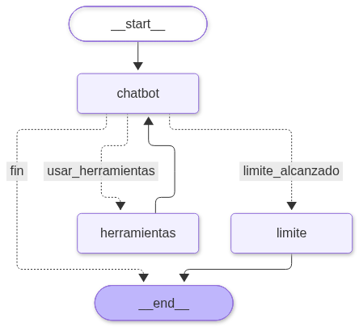

# EventHub v4 — asistente con LangGraph y herramientas

Asistente de atención al cliente de **EventHub**, una plataforma de venta de entradas. Se maneja desde la terminal y está construido con **LangGraph**. Responde sobre las políticas de la empresa y usa dos herramientas para consultar datos reales:

- `buscar_eventos(ciudad, categoria, mes)`: busca en el catálogo de eventos (`data/events.json`).
- `consultar_pedido(id_pedido, email)`: consulta el estado de un pedido (`data/orders.json`). Solo da información si el email coincide con el del pedido.

Este proyecto es autónomo: la carpeta incluye el código, los datos, los tests y la configuración. Se puede copiar a cualquier ubicación.

## El grafo

```
START → chatbot ─┬─(usar_herramientas)─► herramientas ──► chatbot   (bucle)
                 ├─(limite_alcanzado)──► limite ────────► END
                 └─(fin)───────────────► END
```



| Nodo | Qué hace |
|---|---|
| `chatbot` | Llama al modelo con las herramientas enlazadas (`bind_tools`) |
| `herramientas` | Nodo escrito a mano. Ejecuta cada `tool_call` del último `AIMessage` y añade un `ToolMessage` por cada una. Si la herramienta no existe o los argumentos no son válidos, devuelve un error en vez de fallar |
| `limite` | Corta el bucle cuando se llega a `MAX_PASOS = 5` rondas de herramientas en un turno. Responde a las llamadas pendientes con «no ejecutada» y termina con un mensaje amable que remite a soporte |

- La **arista condicional** que sale de `chatbot` (`ruta_tras_chatbot`) decide entre `herramientas`, `limite` o `END`.
- El estado `EstadoV4` amplía `MessagesState` con un contador `pasos`, que se pone a 0 al empezar cada turno.
- La **memoria** la guarda un checkpointer `InMemorySaver`. Cada conversación es un hilo (`thread_id`) con su propio historial. Se pierde al cerrar el programa.

## Estructura

```
version4/
├── README.md
├── pyproject.toml            # metadatos, dependencias, comando eventhub-v4, config de pytest
├── requirements.txt          # alternativa: pip install -r requirements.txt (incluye el propio paquete)
├── .env.example              # plantilla de configuración (cópiala a .env)
├── data/                     # datos de ejemplo: events.json, orders.json, policies.md
├── diagramas/                # v4.mmd (se regenera al arrancar) y v4.png
├── src/eventhub_v4/
│   ├── __main__.py           # permite ejecutar python -m eventhub_v4
│   ├── config/settings.py    # lee .env: clave, modelo, temperatura, carpeta de datos
│   ├── llm/models.py         # crea el ChatOpenAI
│   ├── llm/prompts.py        # reglas sobre políticas y lectura de policies.md
│   ├── services/             # lógica de datos: datos.py, eventos.py, pedidos.py
│   ├── tools/eventhub_tools.py   # las herramientas @tool que ve el modelo
│   └── grafos/
│       ├── comun.py          # prompt de sistema y guardado de diagramas
│       └── v4_herramientas.py    # el grafo, el turno de conversación y el bucle de terminal
└── tests/                    # pytest con un modelo falso (no llama a OpenAI)
```

## Requisitos

- Python 3.11 o superior
- Una clave de API de OpenAI (solo para usar el asistente; los tests no la necesitan)

## Instalación

Desde la carpeta `version4/`:

```bash
python -m venv .venv
source .venv/bin/activate          # Windows: .venv\Scripts\activate
pip install -e ".[dev]"
```

Instálalo con `-e` (modo editable). Así el programa encuentra `.env`, `data/` y `diagramas/` en esta carpeta.

## Configuración

```bash
cp .env.example .env
```

Edita `.env`:

| Variable | Obligatoria | Descripción |
|---|---|---|
| `OPENAI_API_KEY` | Sí | Clave de la API de OpenAI |
| `OPENAI_MODEL` | No | Modelo de chat. Por defecto `gpt-4.1-mini` |
| `OPENAI_TEMPERATURE` | No | Temperatura, p. ej. `0`. Déjala vacía si tu modelo no admite el parámetro (modelos de razonamiento) |
| `EVENTHUB_DATA_DIR` | No | Otra carpeta de datos. Por defecto `data/` |

Las variables que ya existan en el entorno tienen prioridad sobre el `.env`.

## Ejecución

```bash
python -m eventhub_v4
# o bien, el comando que instala pip:
eventhub-v4
```

Al arrancar guarda el diagrama en `diagramas/v4.mmd`. Comandos del chat:

| Comando | Qué hace |
|---|---|
| `/hilo <id>` | Cambia de conversación. Cada hilo tiene su propia memoria |
| `/historial` | Muestra el estado guardado del hilo (`get_state`): los mensajes, los `tool_calls`, los `ToolMessage` y el contador `pasos` |
| `salir` (o `exit`, `quit`, Ctrl+D) | Termina |

Antes de cada respuesta se muestran las herramientas que se han llamado:

```
[hilo-1] Tú: ¿Mi pedido EH-1003 es para un concierto en Madrid? Si es así, dime otros conciertos en Madrid ese mes. Mi email es ana.gomez@example.com
  ↳ consultar_pedido({"id_pedido": "EH-1003", "email": "ana.gomez@example.com"})
  ↳ buscar_eventos({"ciudad": "Madrid", "categoria": "concierto", "mes": null})
  ↳ buscar_eventos({"ciudad": "Madrid", "categoria": "concierto", "mes": "2026-12"})
Asistente: Sí. El pedido EH-1003 corresponde a **Rock en la Gran Vía**, un concierto en Madrid el **11 de diciembre de 2026**.

Otros conciertos en Madrid ese mes:
- **Coros de Navidad en el Retiro** — 19 de diciembre, **25 €**; 80 entradas disponibles.
- **Sinfonía de Invierno** — 27 de diciembre, **55 €**; agotado.
```

(Salida real con `gpt-4.1-mini`. El texto exacto cambia entre ejecuciones.)

### Qué probar

| Escribe | Debe pasar |
|---|---|
| La pregunta de arriba **con** email | Encadena `consultar_pedido` y `buscar_eventos` en la misma respuesta |
| La misma pregunta **sin** email | No llama a ninguna herramienta y pide el email |
| EH-1003 con un email incorrecto | Mensaje genérico: no dice si el pedido existe |
| ¿Qué conciertos hay en Madrid en enero de 2027? | `buscar_eventos(..., mes="2027-01")` → solo EV016 |
| ¿Qué conciertos hay en Valencia? → ¿Cuál de esos es el más barato? | Usa la memoria del hilo para saber a qué se refiere «esos» |
| `/historial` | Muestra el estado del hilo con las herramientas y `pasos` |

### Datos de ejemplo

Pedidos para probar (`data/orders.json`):

| Pedido | Email | Estado |
|---|---|---|
| EH-1001 | laura.martinez@example.com | pagado |
| EH-1002 | carlos.ruiz@example.com | enviado |
| EH-1003 | ana.gomez@example.com | pagado |
| EH-1004 | javier.lopez@example.com | reembolsado |
| EH-1005 | marta.sanchez@example.com | pagado |
| EH-1006 | pablo.diaz@example.com | cancelado |

`data/events.json` tiene 16 eventos en varias ciudades (Valencia, Madrid, Málaga…) y categorías (concierto, teatro, deporte, comedia, danza). La v4 solo **lee** los datos, nunca los modifica.

## Tests

```bash
pytest
```

Usan un modelo falso con las respuestas guionizadas y una copia temporal de `data/`, así que no necesitan clave ni conexión. Cubren:

- `tests/test_v4_herramientas.py`: encadenar dos herramientas, terminar sin herramientas, el límite de pasos, el reinicio del contador en cada turno, hilos aislados, herramienta desconocida o argumentos no válidos, y la forma del diagrama.
- `tests/test_servicios.py`: los filtros de eventos (ciudad, categoría, mes, sin distinguir tildes ni mayúsculas) y la verificación de pedidos por email.

## Diagrama en PNG

`diagramas/v4.png` ya viene incluido. Para regenerarlo (necesita internet, porque usa el servicio mermaid.ink):

```bash
python -c "from eventhub_v4.grafos.comun import guardar_diagrama_png; from eventhub_v4.grafos.v4_herramientas import construir_grafo; from tests.conftest import ModeloGuionizado; print(guardar_diagrama_png(construir_grafo(ModeloGuionizado(messages=iter([]))), 'v4'))"
```
