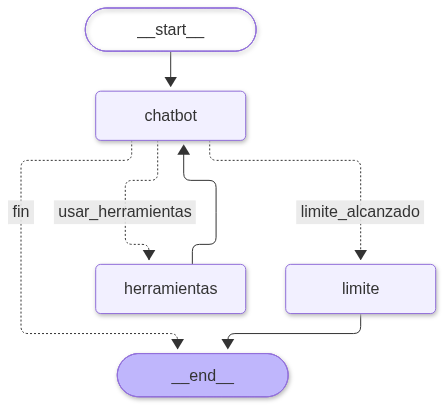

# Tutorial: cómo funciona EventHub v4 por dentro

Este tutorial explica **la aplicación en sí**: qué hace, cómo está organizada, cómo fluye un mensaje desde que lo escribes en la terminal hasta que recibes la respuesta, y por qué el código está escrito como está. No trata la observabilidad ni la evaluación (Langfuse, LangSmith). Para eso están [tutorial-langfuse.md](tutorial-langfuse.md) y [tutorial-langsmith.md](tutorial-langsmith.md).

---

## Índice

1. [Qué es EventHub v4](#1-qué-es-eventhub-v4)
2. [Puesta en marcha rápida](#2-puesta-en-marcha-rápida)
3. [Mapa de la aplicación: las capas](#3-mapa-de-la-aplicación-las-capas)
4. [Capa 0: configuración (`config/settings.py`)](#4-capa-0-configuración-configsettingspy)
5. [Capa 1: los datos (`data/`)](#5-capa-1-los-datos-data)
6. [Capa 2: los servicios (`services/`)](#6-capa-2-los-servicios-services)
7. [Capa 3: las herramientas (`tools/`)](#7-capa-3-las-herramientas-tools)
8. [Capa 4: el modelo y el prompt de sistema (`llm/`)](#8-capa-4-el-modelo-y-el-prompt-de-sistema-llm)
9. [Capa 5: el grafo de LangGraph (`grafos/v4_herramientas.py`)](#9-capa-5-el-grafo-de-langgraph)
10. [Un turno completo, paso a paso](#10-un-turno-completo-paso-a-paso)
11. [La memoria: hilos y checkpointer](#11-la-memoria-hilos-y-checkpointer)
12. [El bucle de la terminal y sus comandos](#12-el-bucle-de-la-terminal-y-sus-comandos)
13. [Errores y casos límite](#13-errores-y-casos-límite)
14. [Cómo se prueba sin llamar a OpenAI](#14-cómo-se-prueba-sin-llamar-a-openai)
15. [Cómo extender la aplicación](#15-cómo-extender-la-aplicación)
16. [Resumen y glosario](#16-resumen-y-glosario)

---

## 1. Qué es EventHub v4

EventHub es una plataforma (ficticia) de venta de entradas. EventHub v4 es su **asistente de atención al cliente**, que se usa desde la terminal. Sabe hacer tres cosas:

| Tipo de pregunta | Ejemplo | Cómo la responde |
|---|---|---|
| **Políticas** | «¿Hasta cuándo puedo devolver una entrada?» | Con el texto de `data/policies.md`, que va incluido en el prompt de sistema. No usa herramientas |
| **Eventos** | «¿Qué conciertos hay en Valencia en diciembre?» | Llama a la herramienta `buscar_eventos`, que consulta `data/events.json` |
| **Pedidos** | «¿Cómo va mi pedido EH-1001? Mi email es …» | Llama a la herramienta `consultar_pedido`, que consulta `data/orders.json` y solo responde si el email coincide |

Además puede **encadenar** herramientas en un mismo turno (por ejemplo, consultar un pedido para saber de qué evento es y luego buscar eventos parecidos) y **recuerda** la conversación, así que entiende referencias como «¿y el más barato de esos?».

Por debajo hay tres piezas principales:

- **Un modelo de lenguaje de OpenAI** (`ChatOpenAI`, por defecto `gpt-4.1-mini`), que entiende la pregunta, decide si necesita herramientas y redacta la respuesta.
- **Herramientas** (funciones Python) que el modelo puede pedir que se ejecuten para obtener datos reales.
- **Un grafo de LangGraph** que coordina todo: llama al modelo, ejecuta las herramientas que pide, vuelve a llamar al modelo con los resultados y guarda el historial.

> **Idea clave:** el modelo **nunca** lee los ficheros JSON ni ejecuta código. Solo *pide* que se ejecute una herramienta con ciertos argumentos. Es el grafo quien la ejecuta y le devuelve el resultado como un mensaje más.

---

## 2. Puesta en marcha rápida

```bash
python -m venv .venv
source .venv/bin/activate
pip install -e ".[dev]"     # el modo editable (-e) es obligatorio, ver sección 4
cp .env.example .env        # y pon tu OPENAI_API_KEY
python -m eventhub_v4       # o: eventhub-v4
```

Al arrancar verás algo así:

```
Diagrama guardado en .../diagramas/v4.mmd
Asistente EventHub (v4, con herramientas, prompt-local). Comandos: /hilo <id>, /usuario <id>, /historial, salir.

[hilo-1] Tú:
```

Para ejecutar los tests (no necesitan clave ni red):

```bash
pytest
```

---

## 3. Mapa de la aplicación: las capas

El código está organizado en capas. Cada una solo usa las que están por debajo:

```
┌──────────────────────────────────────────────────────────────────┐
│  grafos/v4_herramientas.py                                       │
│  main() → bucle de terminal → enviar() → grafo LangGraph         │  ← Capa 5
├──────────────────────────────────────────────────────────────────┤
│  llm/models.py          llm/prompt_gestionado.py   llm/prompts.py│  ← Capa 4
│  crear_modelo()         obtener_prompt()           cargar_politicas()
├──────────────────────────────────────────────────────────────────┤
│  tools/eventhub_tools.py                                         │  ← Capa 3
│  @tool buscar_eventos      @tool consultar_pedido   (→ JSON str) │
├──────────────────────────────────────────────────────────────────┤
│  services/eventos.py       services/pedidos.py   services/datos.py│ ← Capa 2
│  lógica pura de filtrado y verificación                          │
├──────────────────────────────────────────────────────────────────┤
│  data/events.json   data/orders.json   data/policies.md          │  ← Capa 1
├──────────────────────────────────────────────────────────────────┤
│  config/settings.py  (lee .env y variables de entorno)           │  ← Capa 0
└──────────────────────────────────────────────────────────────────┘
```

Esta separación tiene ventajas concretas:

- Los **servicios** no saben nada de LLMs: se pueden probar con un simple `assert`.
- Las **herramientas** son envoltorios finos: solo traducen entre el mundo del modelo (texto/JSON) y los servicios.
- El **grafo** no sabe cómo se buscan los eventos: solo sabe ejecutar herramientas por su nombre.
- Solo hay **un sitio** donde se crea el cliente de OpenAI (`crear_modelo()`), así que cambiar de modelo o de parámetros es trivial.

Estructura de ficheros relevante:

```
.
├── data/                       # datos de ejemplo (solo lectura)
│   ├── events.json             # 16 eventos
│   ├── orders.json             # 6 pedidos
│   └── policies.md             # políticas de la empresa
├── prompts/
│   ├── eventhub_sistema_v1.txt # texto del prompt de sistema (versión 1)
│   └── eventhub_sistema_v2.txt # versión 2
├── diagramas/v4.mmd, v4.png    # diagrama del grafo
├── src/eventhub_v4/
│   ├── __main__.py             # python -m eventhub_v4 → main()
│   ├── config/settings.py
│   ├── services/{datos,eventos,pedidos}.py
│   ├── tools/eventhub_tools.py
│   ├── llm/{models,prompts,prompt_gestionado}.py
│   └── grafos/{comun,v4_herramientas}.py
└── tests/
```

Vamos capa por capa, de abajo arriba.

---

## 4. Capa 0: configuración (`config/settings.py`)

[settings.py](../src/eventhub_v4/config/settings.py) centraliza todo lo que se puede configurar. Lo importante:

```python
RAIZ_PROYECTO = Path(__file__).resolve().parents[3]
load_dotenv(RAIZ_PROYECTO / ".env")
```

- **La raíz del proyecto se calcula a partir de la ubicación del propio fichero** (`src/eventhub_v4/config/settings.py` → subir 3 niveles). Por eso la instalación debe ser editable (`pip install -e`): si el paquete se copiara a `site-packages`, `parents[3]` ya no apuntaría a la carpeta donde están `.env`, `data/`, `prompts/` y `diagramas/`.
- `load_dotenv` **no pisa** variables que ya existan en el entorno: si exportas `OPENAI_MODEL=gpt-4.1` en tu shell, gana sobre el `.env`.

Funciones que usa la aplicación:

| Función | Variable | Valor por defecto | Para qué |
|---|---|---|---|
| `openai_api_key()` | `OPENAI_API_KEY` | — | Clave de OpenAI |
| `openai_model()` | `OPENAI_MODEL` | `gpt-4.1-mini` | Modelo de chat |
| `openai_temperature()` | `OPENAI_TEMPERATURE` | vacío → `None` | Temperatura; vacía significa «no enviarla» |
| `data_dir()` | `EVENTHUB_DATA_DIR` | `<raíz>/data` | Carpeta de datos |
| `prompts_dir()` | — | `<raíz>/prompts` | Textos del prompt de sistema |
| `diagramas_dir()` | — | `<raíz>/diagramas` | Dónde se guarda el diagrama |
| `marca()` / `tono()` | `EVENTHUB_MARCA` / `EVENTHUB_TONO` | `EventHub` / `cercano y profesional` | Variables que se sustituyen en el prompt |

Dos detalles de diseño:

- **`data_dir()` se evalúa en cada llamada**, no una vez al importar. Así los tests pueden cambiar `EVENTHUB_DATA_DIR` en tiempo de ejecución y apuntar a una copia temporal de los datos.
- **Temperatura vacía = no se envía**. Los modelos de razonamiento de OpenAI rechazan el parámetro `temperature`; dejando la variable vacía se puede usar cualquier modelo sin tocar código.

---

## 5. Capa 1: los datos (`data/`)

La aplicación **solo lee** datos; nada escribe nunca en estos ficheros.

### `events.json` — catálogo de eventos

Una lista de 16 eventos en 5 ciudades (Barcelona, Madrid, Málaga, Sevilla, Valencia) y 5 categorías (comedia, concierto, danza, deporte, teatro):

```json
{
  "id": "EV013",
  "nombre": "Rock en la Gran Vía",
  "ciudad": "Madrid",
  "categoria": "concierto",
  "fecha": "2026-12-11T21:00:00",
  "precio": 38.0,
  "disponibles": 150
}
```

`disponibles: 0` significa agotado (por ejemplo, `EV015 Sinfonía de Invierno`).

### `orders.json` — pedidos

6 pedidos con estados `pagado`, `enviado`, `reembolsado` y `cancelado`:

```json
{
  "id_pedido": "EH-1003",
  "email": "ana.gomez@example.com",
  "id_evento": "EV013",
  "cantidad": 1,
  "estado": "pagado",
  "fecha_compra": "2026-09-30T09:45:00"
}
```

### `policies.md` — políticas

Texto en Markdown con cinco secciones: devoluciones, cambio de titular, cancelación o aplazamiento, entradas agotadas y contacto con soporte. **No hay herramienta para las políticas**: el fichero entero se inyecta en el prompt de sistema (sección 8), de modo que el modelo siempre lo tiene delante.

---

## 6. Capa 2: los servicios (`services/`)

Los servicios son Python puro: reciben parámetros, leen los JSON y devuelven diccionarios o listas. No saben que existe un LLM.

### `datos.py` — lectura de ficheros

```python
def leer_json(nombre: str) -> Any:
    with ruta(nombre).open(encoding="utf-8") as f:
        return json.load(f)
```

Se lee el fichero en cada consulta (no hay caché). Con datos tan pequeños es lo más simple y garantiza que siempre se usa la carpeta que indique `data_dir()` en ese momento.

### `eventos.py` — búsqueda de eventos

[eventos.py](../src/eventhub_v4/services/eventos.py) expone `buscar_eventos(ciudad=None, categoria=None, mes=None)`:

1. **Valida el mes.** Si se da, debe cumplir el patrón `AAAA-MM` con mes de `01` a `12` (`^\d{4}-(0[1-9]|1[0-2])$`). Si no, lanza `ValueError` con un mensaje que explica el formato correcto. `"2026-13"`, `"diciembre"` o `"2026-1"` son inválidos.
2. **Filtra.** Los filtros vacíos (`None` o `""`) se ignoran. Cada evento debe cumplir todos los filtros dados:
   - `mes`: la fecha ISO del evento empieza por `"2026-12"`.
   - `ciudad` y `categoria`: comparación **normalizada**.
3. **Recorta los campos** a `id, nombre, ciudad, categoria, fecha, precio, disponibles`.
4. **Ordena por fecha.**

La normalización es la que permite que el usuario (o el modelo) escriba «malaga», «MÁLAGA» o «Málaga » y obtenga lo mismo:

```python
def normalizar(texto: str) -> str:
    """Minúsculas, sin tildes y sin espacios sobrantes: 'Málaga ' → 'malaga'."""
    sin_tildes = unicodedata.normalize("NFKD", texto)
    sin_tildes = "".join(c for c in sin_tildes if not unicodedata.combining(c))
    return sin_tildes.casefold().strip()
```

`NFKD` descompone «á» en «a» + tilde combinante; luego se descartan los caracteres combinantes y se pasa a minúsculas con `casefold()`.

Ejemplo:

```python
>>> buscar_eventos(ciudad="madrid", categoria="Concierto", mes="2026-12")
[{"id": "EV013", "nombre": "Rock en la Gran Vía", ...},
 {"id": "EV014", "nombre": "Coros de Navidad en el Retiro", ...},
 {"id": "EV015", "nombre": "Sinfonía de Invierno", ..., "disponibles": 0}]
```

`EV016 Pop Madrid Live` queda fuera porque es de enero de 2027. Los eventos agotados **sí** se incluyen: es información útil para el usuario.

### `pedidos.py` — consulta de pedidos

[pedidos.py](../src/eventhub_v4/services/pedidos.py) expone `consultar_pedido(id_pedido, email)`:

- El id se normaliza a mayúsculas (`eh-1003` → `EH-1003`) y el email se compara sin distinguir mayúsculas.
- Si **id y email coinciden** con un pedido, devuelve `{"encontrado": True, id_pedido, id_evento, cantidad, estado, fecha_compra}`. Nunca devuelve el email.
- En **cualquier otro caso** devuelve `{"encontrado": False, "mensaje": MENSAJE_PEDIDO_NO_VERIFICADO}`.

El detalle importante de seguridad: **el mensaje es exactamente el mismo si el pedido no existe que si existe pero el email no coincide**. Si fueran distintos («ese pedido no existe» frente a «el email no coincide»), alguien podría probar identificadores para averiguar cuáles existen. Por la misma razón, el prompt pide al modelo que «no dé pistas sobre si el pedido existe».

---

## 7. Capa 3: las herramientas (`tools/`)

[eventhub_tools.py](../src/eventhub_v4/tools/eventhub_tools.py) convierte los servicios en **herramientas** que el modelo puede pedir, usando el decorador `@tool` de LangChain.

```python
@tool
def buscar_eventos(
    ciudad: str | None = None, categoria: str | None = None, mes: str | None = None
) -> str:
    """Busca eventos de EventHub en el catálogo.

    Úsala siempre que el usuario pregunte por eventos, fechas, precios o
    disponibilidad. ...

    Args:
        ciudad: Ciudad del evento, p. ej. "Valencia", "Madrid".
        categoria: Tipo de evento, p. ej. "concierto", "teatro", ...
        mes: Mes del evento en formato "AAAA-MM", p. ej. "2026-12" ...
    """
    try:
        return _json(eventos.buscar_eventos(ciudad=ciudad, categoria=categoria, mes=mes))
    except ValueError as e:
        return _json({"error": str(e)})
```

### Qué ve el modelo

Cuando el grafo hace `modelo.bind_tools(HERRAMIENTAS)`, LangChain transforma cada herramienta en un **esquema JSON** que se envía a OpenAI junto con cada petición. Ese esquema se construye a partir de:

- el **nombre** de la función (`buscar_eventos`),
- los **type hints** (`str | None = None` → parámetro opcional de tipo string),
- el **docstring** (descripción general y descripción de cada argumento en `Args:`).

Por tanto, **el docstring es parte del prompt**. Frases como «Úsala siempre que el usuario pregunte por eventos» o «si el usuario no ha dado alguno de los dos, pídeselo antes de llamar» guían directamente el comportamiento del modelo. Cambiar un docstring cambia cómo se comporta el asistente.

### Por qué devuelven texto JSON

Las herramientas devuelven un `str` con JSON (`ensure_ascii=False` para conservar tildes), no un objeto Python. El resultado de una herramienta acaba siendo el contenido de un `ToolMessage` que se envía al modelo, y el modelo solo lee texto.

### Errores como datos, no como excepciones

Si el mes no es válido, la herramienta **no lanza** la excepción: devuelve `{"error": "Mes no válido: '2026-13'. Usa el formato AAAA-MM, p. ej. '2026-12'."}`. El modelo lee ese error y normalmente corrige la llamada él solo en la siguiente vuelta. Es mucho más robusto que dejar que la conversación se rompa.

### Las dos herramientas

| Herramienta | Argumentos | Devuelve |
|---|---|---|
| `buscar_eventos` | `ciudad?`, `categoria?`, `mes?` (todos opcionales) | Lista JSON de eventos o `{"error": ...}` |
| `consultar_pedido` | `id_pedido`, `email` (ambos obligatorios) | `{"encontrado": true, ...}` o `{"encontrado": false, "mensaje": ...}` |

---

## 8. Capa 4: el modelo y el prompt de sistema (`llm/`)

### El modelo: `crear_modelo()`

[models.py](../src/eventhub_v4/llm/models.py) es el **único** lugar donde se crea el cliente de OpenAI:

```python
def crear_modelo() -> ChatOpenAI:
    kwargs = {}
    temperatura = openai_temperature()
    if temperatura is not None:
        kwargs["temperature"] = temperatura
    return ChatOpenAI(model=openai_model(), api_key=openai_api_key(), **kwargs)
```

Con `OPENAI_TEMPERATURE=0` las respuestas son más deterministas y menos propensas a inventar datos.

### El prompt de sistema

El prompt de sistema **no está escrito en el código Python**. Vive en ficheros de texto en [prompts/](../prompts/) (`eventhub_sistema_v1.txt`, `eventhub_sistema_v2.txt`) y es una **plantilla** con tres variables:

| Variable | De dónde sale |
|---|---|
| `{{marca}}` | `EVENTHUB_MARCA` (por defecto `EventHub`) |
| `{{tono}}` | `EVENTHUB_TONO` (por defecto `cercano y profesional`) |
| `{{politicas}}` | El contenido completo de `data/policies.md` (lo lee `cargar_politicas()` en [prompts.py](../src/eventhub_v4/llm/prompts.py)) |

El prompt tiene tres bloques:

1. **Rol y tono**: «Eres el asistente de atención al cliente de EventHub…».
2. **Reglas para políticas**: responder solo con lo que está escrito, no inventar plazos ni importes, remitir a soporte si no se sabe.
3. **Reglas para herramientas**: usar siempre `buscar_eventos` para datos de eventos (nunca de memoria), pasar los filtros conocidos, convertir «en diciembre» o «ese mes» a `AAAA-MM`, pedir id y email antes de `consultar_pedido`, se pueden encadenar herramientas, etc.

Al final se incrustan las políticas entre `=== POLÍTICAS DE EventHub ===` y `=== FIN DE LAS POLÍTICAS ===`. Como las políticas se inyectan al compilar la plantilla, **cambiar `policies.md` no obliga a tocar el prompt**.

### `obtener_prompt()` y `PromptSistema`

[prompt_gestionado.py](../src/eventhub_v4/llm/prompt_gestionado.py) carga la plantilla y la empaqueta en un objeto `PromptSistema`. (La aplicación también puede descargar el prompt de un gestor externo; eso queda fuera de este tutorial. Sin esa configuración, que es el caso por defecto y el de los tests, se usa la copia local `prompts/eventhub_sistema_v1.txt`.)

Dos transformaciones merecen atención:

**a) De `{{var}}` a `{var}`.** Los ficheros usan la sintaxis de doble llave, pero las plantillas de LangChain usan llave simple. `_a_langchain()` convierte `{{marca}}` en `{marca}` y, a la vez, **escapa cualquier otra llave** del texto (`{` → `{{`) para que LangChain no la confunda con una variable. Sin esto, un `{` suelto en las políticas haría fallar la plantilla.

**b) La plantilla de chat.** `plantilla_chat()` construye un `ChatPromptTemplate` con dos partes:

```python
ChatPromptTemplate([("system", self.plantilla), MessagesPlaceholder("messages")])
    .partial(**self.variables)
```

- Un mensaje `system` con el prompt (las tres variables ya rellenadas con `.partial`).
- Un `MessagesPlaceholder("messages")` donde se coloca **todo el historial** de la conversación.

Es decir, en cada llamada al modelo se envía: *[prompt de sistema] + [todos los mensajes del hilo]*. El prompt de sistema **no se guarda** en el historial; se antepone de nuevo en cada llamada.

`PromptSistema.etiqueta` vale `prompt-local` cuando se usa la copia local (o `prompt-vN` si viene de una versión concreta); es lo que ves en el mensaje de bienvenida.

---

## 9. Capa 5: el grafo de LangGraph

Este es el corazón de la aplicación: [v4_herramientas.py](../src/eventhub_v4/grafos/v4_herramientas.py).

### 9.1 ¿Qué es un grafo de LangGraph?

LangGraph modela una aplicación como un **grafo de estados**:

- Un **estado** compartido (un diccionario tipado).
- **Nodos**: funciones que reciben el estado y devuelven una *actualización parcial* del estado.
- **Aristas**: qué nodo se ejecuta después. Pueden ser fijas o **condicionales** (una función decide el siguiente nodo mirando el estado).
- `START` y `END`: puntos de entrada y salida.

### 9.2 La forma del grafo

```
START → chatbot ─┬─(usar_herramientas)─► herramientas ──► chatbot   (bucle)
                 ├─(limite_alcanzado)──► limite ────────► END
                 └─(fin)───────────────► END
```



Tres nodos y un bucle: el modelo puede pedir herramientas, recibir los resultados y volver a pedir más, hasta que decide responder (o se alcanza el límite).

### 9.3 El estado: `EstadoV4`

```python
class EstadoV4(MessagesState):
    pasos: int
```

- **`messages`** (heredado de `MessagesState`): la lista de mensajes de la conversación. Tiene un **reducer** `add_messages`: cuando un nodo devuelve `{"messages": [m]}`, el mensaje se **añade** a la lista, no la sustituye.
- **`pasos`**: cuántas rondas de herramientas se han ejecutado **en el turno actual**. **No tiene reducer**: el último valor escrito sustituye al anterior.

Los tipos de mensaje que aparecen en `messages`:

| Clase | `type` | Quién lo crea | Contenido |
|---|---|---|---|
| `HumanMessage` | `human` | `enviar()` | Lo que escribe el usuario |
| `AIMessage` | `ai` | nodo `chatbot` (o `limite`) | Respuesta de texto **o** petición de herramientas (`tool_calls`) |
| `ToolMessage` | `tool` | nodo `herramientas` (o `limite`) | Resultado de una herramienta, con el `tool_call_id` al que responde |

### 9.4 Construcción: `construir_grafo()`

```python
def construir_grafo(modelo=None, checkpointer=None, prompt=None):
    prompt = prompt or obtener_prompt()
    modelo_con_herramientas = (modelo or crear_modelo()).bind_tools(HERRAMIENTAS)
    cadena_chatbot = (prompt.plantilla_chat() | modelo_con_herramientas).with_config(
        run_name="generar-respuesta"
    )
    ...
    return builder.compile(checkpointer=checkpointer or InMemorySaver())
```

- Los tres parámetros son **inyectables**: en producción se dejan a `None` (modelo real de OpenAI, memoria en RAM, prompt por defecto); en los tests se pasa un modelo falso.
- `bind_tools(HERRAMIENTAS)` adjunta los esquemas de las herramientas a cada llamada al modelo.
- `cadena_chatbot` es un *pipeline* de LangChain: `plantilla → modelo`. Recibe `{"messages": [...]}`, antepone el prompt de sistema y llama al modelo.
- `HERRAMIENTAS_POR_NOMBRE = {"buscar_eventos": ..., "consultar_pedido": ...}` permite buscar la herramienta por el nombre que pide el modelo.

### 9.5 Nodo `chatbot`

```python
def chatbot(estado):
    respuesta = cadena_chatbot.invoke({"messages": estado["messages"]})
    return {"messages": [respuesta]}
```

Envía el historial completo al modelo y añade su respuesta (un `AIMessage`) al estado. Esa respuesta puede ser:

- **Texto final** (`tool_calls` vacío): el modelo ya sabe responder.
- **Petición de herramientas** (`tool_calls` con una o varias entradas): por ejemplo,

  ```python
  AIMessage(content="", tool_calls=[
      {"id": "call_abc", "name": "consultar_pedido",
       "args": {"id_pedido": "EH-1003", "email": "ana.gomez@example.com"}}
  ])
  ```

  El modelo puede pedir **varias herramientas a la vez** en un solo `AIMessage` (llamadas en paralelo).

### 9.6 Arista condicional `ruta_tras_chatbot`

```python
def ruta_tras_chatbot(estado):
    ultimo = _ultimo_ai(estado)
    if not ultimo or not ultimo.tool_calls:
        return "fin"
    if estado.get("pasos", 0) >= MAX_PASOS:
        return "limite_alcanzado"
    return "usar_herramientas"
```

Después de cada ejecución de `chatbot` se decide:

| Condición | Ruta | Siguiente nodo |
|---|---|---|
| El último mensaje no pide herramientas | `fin` | `END` |
| Pide herramientas pero ya van `MAX_PASOS` (5) rondas | `limite_alcanzado` | `limite` |
| Pide herramientas y queda margen | `usar_herramientas` | `herramientas` |

### 9.7 Nodo `herramientas` (escrito a mano)

LangGraph trae un `ToolNode` ya hecho, pero aquí se escribe a mano para controlar exactamente qué pasa en cada caso:

```python
def herramientas(estado):
    resultados = []
    for llamada in _ultimo_ai(estado).tool_calls:
        herramienta = HERRAMIENTAS_POR_NOMBRE.get(llamada["name"])
        if herramienta is None:
            contenido, estado_msg = '{"error": "La herramienta ... no existe."}', "error"
        else:
            try:
                contenido, estado_msg = herramienta.invoke(llamada["args"]), "success"
            except Exception as e:
                contenido, estado_msg = json.dumps({"error": str(e)}), "error"
        resultados.append(ToolMessage(
            content=contenido, tool_call_id=llamada["id"], name=llamada["name"], status=estado_msg,
        ))
    return {"messages": resultados, "pasos": estado.get("pasos", 0) + 1}
```

Para **cada** `tool_call` del último `AIMessage`:

1. Busca la herramienta por nombre.
2. Si no existe (el modelo «alucinó» una herramienta, p. ej. `reservar_entradas`) → `ToolMessage` de error.
3. Si existe, la invoca con los argumentos. Si los argumentos no son válidos (p. ej. falta `email`, que es obligatorio) LangChain lanza una excepción de validación → se captura y se convierte en `ToolMessage` de error.
4. Cada `ToolMessage` lleva el **`tool_call_id`** de la llamada a la que responde. Así el modelo sabe qué resultado corresponde a qué petición, y OpenAI lo exige.

Al terminar incrementa `pasos` en 1 (una **ronda**, aunque haya ejecutado varias herramientas en ella) y la arista fija `herramientas → chatbot` devuelve el control al modelo, que ahora ve los resultados.

### 9.8 Nodo `limite`

Protege contra bucles infinitos: un modelo que pide herramientas una y otra vez sin llegar a responder.

```python
def limite(estado):
    pendientes = [
        ToolMessage(content='{"error": "No ejecutada: límite de pasos alcanzado."}',
                    tool_call_id=llamada["id"], name=llamada["name"], status="error")
        for llamada in _ultimo_ai(estado).tool_calls
    ]
    return {"messages": [*pendientes, AIMessage(MENSAJE_LIMITE)]}
```

Hace dos cosas, y el orden importa:

1. **Responde a todas las `tool_calls` pendientes** con un `ToolMessage` «no ejecutada». Esto es imprescindible: OpenAI **rechaza** cualquier historial que contenga un `AIMessage` con `tool_calls` sin sus `ToolMessage` correspondientes. Si no se hiciera, el siguiente mensaje del usuario en ese hilo fallaría con un error de la API y la conversación quedaría rota para siempre.
2. Añade un `AIMessage` con `MENSAJE_LIMITE`, un mensaje amable que pide reformular la pregunta y da el contacto de soporte.

Fíjate en que `limite` no llama al modelo: la respuesta es fija.

### 9.9 Por qué `pasos` se reinicia en cada turno

El límite es **por turno**, no por conversación. Si fuera acumulativo, una conversación larga acabaría bloqueada. Como `pasos` no tiene reducer, basta con que `enviar()` pase `"pasos": 0` en cada invocación para sobrescribir el valor guardado del turno anterior (ver sección 10).

---

## 10. Un turno completo, paso a paso

Sigamos la pregunta de ejemplo del enunciado en un hilo nuevo:

> «¿Mi pedido EH-1003 es para un concierto en Madrid? Si es así, dime otros conciertos en Madrid ese mes. Mi email es ana.gomez@example.com»

### Paso 0 — `enviar()`

El bucle de la terminal llama a:

```python
enviar(grafo, "hilo-1", texto, usuario=..., tags=["cli"], metadata=...)
```

`enviar()`:

1. Construye la config con `thread_id="hilo-1"`.
2. Cuenta los mensajes que ya había en el hilo (`previos`), para saber después cuáles son de este turno.
3. Invoca el grafo:

   ```python
   grafo.invoke({"messages": [HumanMessage(texto)], "pasos": 0}, config)
   ```

   El checkpointer recupera el estado guardado del hilo, el reducer **añade** el `HumanMessage` al historial y `pasos` se **sobrescribe** a 0.

(`enviar()` también envuelve la invocación en un contexto de trazado; sin configuración de observabilidad no hace nada.)

### Paso 1 — `chatbot` (1ª vez)

El modelo recibe `[sistema] + [human]`. Necesita saber de qué evento es el pedido, así que responde:

```
AIMessage(tool_calls=[consultar_pedido(id_pedido="EH-1003", email="ana.gomez@example.com")])
```

`ruta_tras_chatbot` → hay `tool_calls`, `pasos=0 < 5` → **`usar_herramientas`**.

### Paso 2 — `herramientas` (ronda 1)

Ejecuta `consultar_pedido`. El email coincide:

```
ToolMessage(tool_call_id=..., content='{"encontrado": true, "id_pedido": "EH-1003",
            "id_evento": "EV013", "cantidad": 1, "estado": "pagado", ...}')
```

`pasos` pasa a 1. Vuelta a `chatbot`.

### Paso 3 — `chatbot` (2ª vez)

El modelo ve que el pedido es del evento `EV013`, pero no sabe qué evento es. Pide buscarlo; según cómo razone, puede buscar directamente conciertos en Madrid en diciembre o hacer primero una búsqueda más amplia para encontrar la fecha de `EV013` (en el README se ve una ejecución real que hace dos búsquedas). Supongamos:

```
AIMessage(tool_calls=[buscar_eventos(ciudad="Madrid", categoria="concierto", mes="2026-12")])
```

→ **`usar_herramientas`**.

### Paso 4 — `herramientas` (ronda 2)

```
ToolMessage(content='[{"id": "EV013", "nombre": "Rock en la Gran Vía", ...},
                      {"id": "EV014", "nombre": "Coros de Navidad en el Retiro", ...},
                      {"id": "EV015", "nombre": "Sinfonía de Invierno", ..., "disponibles": 0}]')
```

`pasos` pasa a 2. Vuelta a `chatbot`.

### Paso 5 — `chatbot` (3ª vez)

Con toda la información, el modelo redacta la respuesta final, sin `tool_calls`:

```
AIMessage("Sí. El pedido EH-1003 corresponde a Rock en la Gran Vía, un concierto en
Madrid el 11 de diciembre de 2026. Otros conciertos en Madrid ese mes: ...")
```

`ruta_tras_chatbot` → **`fin`** → `END`.

### Paso 6 — de vuelta en `enviar()`

El checkpointer ya ha guardado el estado final del hilo. El historial queda así:

```
[1] human: ¿Mi pedido EH-1003 es para un concierto en Madrid? ...
[2] ai (tool_calls): consultar_pedido({...})
[3] tool [consultar_pedido]: {"encontrado": true, ...}
[4] ai (tool_calls): buscar_eventos({...})
[5] tool [buscar_eventos]: [...]
[6] ai: Sí. El pedido EH-1003 corresponde a ...
```

`enviar()` toma los mensajes nuevos (desde `previos` en adelante) y devuelve:

```python
{
    "respuesta": "Sí. El pedido EH-1003 corresponde a ...",
    "herramientas": [
        {"nombre": "consultar_pedido", "argumentos": {...}},
        {"nombre": "buscar_eventos", "argumentos": {...}},
    ],
    "pasos": 2,
}
```

Y la terminal muestra:

```
  ↳ consultar_pedido({"id_pedido": "EH-1003", "email": "ana.gomez@example.com"})
  ↳ buscar_eventos({"ciudad": "Madrid", "categoria": "concierto", "mes": "2026-12"})
Asistente: Sí. El pedido EH-1003 corresponde a ...
```

### Diagrama de secuencia

```
Usuario      enviar()        chatbot        Modelo OpenAI     herramientas     services
   │  texto     │               │                 │                 │              │
   ├───────────►│ invoke        │                 │                 │              │
   │            ├──────────────►│  sistema+hist   │                 │              │
   │            │               ├────────────────►│                 │              │
   │            │               │◄── tool_calls ──┤                 │              │
   │            │               ├────────────────────────────────►  │ consultar    │
   │            │               │                 │                 ├─────────────►│
   │            │               │◄──────── ToolMessage ─────────────┤◄─────────────┤
   │            │               ├────────────────►│                 │              │
   │            │               │◄── tool_calls ──┤                 │              │
   │            │               ├────────────────────────────────►  │ buscar       │
   │            │               │◄──────── ToolMessage ─────────────┤◄─────────────┤
   │            │               ├────────────────►│                 │              │
   │            │               │◄──── texto ─────┤                 │              │
   │            │◄── END ───────┤                 │                 │              │
   │◄───────────┤ respuesta     │                 │                 │              │
```

### Variante: una pregunta de políticas

«¿Puedo cambiar el titular de mi entrada?» → `chatbot` → el modelo responde directamente con lo que dice `policies.md` (está en el prompt) → `fin`. Un solo paso por el modelo, `pasos = 0`, ninguna herramienta.

### Variante: faltan datos

«¿Cómo va mi pedido EH-1003?» → el docstring de `consultar_pedido` y el prompt dicen que se necesitan id **y** email → el modelo responde pidiendo el email, sin llamar a la herramienta → `fin`.

---

## 11. La memoria: hilos y checkpointer

### Cómo funciona

El grafo se compila con un **checkpointer** `InMemorySaver`. Un checkpointer guarda una «foto» (*checkpoint*) del estado después de cada paso del grafo, indexada por `thread_id`:

```python
def config_hilo(thread_id: str) -> dict:
    return {"configurable": {"thread_id": thread_id}}
```

- Al invocar el grafo con un `thread_id`, LangGraph **carga** el último estado de ese hilo, aplica la entrada y, al terminar, **guarda** el nuevo estado.
- Cada hilo es independiente: lo que se dice en `hilo-1` no se ve en `hilo-2`.
- Un hilo que nunca se ha usado tiene estado vacío (`{}`).

Gracias a esto, en el segundo turno el modelo recibe **todo** el historial anterior (incluidos los `ToolMessage` con los datos de eventos), y por eso puede resolver «¿y cuál es el más barato de esos?» sin volver a buscar.

### Limitaciones

- `InMemorySaver` guarda en RAM: **al cerrar el programa se pierde todo**. Para persistir habría que pasar otro checkpointer (por ejemplo, uno basado en SQLite) a `construir_grafo(checkpointer=...)`; el resto del código no cambia.
- El historial crece sin límite dentro de un hilo y se envía entero en cada llamada al modelo. En conversaciones muy largas aumentaría el coste y podría superar la ventana de contexto. Para el uso de este proyecto no es un problema.

### Inspeccionar el estado: `/historial`

`formatear_estado()` usa `grafo.get_state(config_hilo(hilo))` y muestra:

```
get_state(thread_id='hilo-1')
  mensajes guardados: 6
  pasos (último turno): 2
  next: ()  (vacío = el grafo terminó el turno)
  checkpoint_id: 1f0...
  [1] human: ¿Mi pedido EH-1003 es para ...
  [2] ai (tool_calls): consultar_pedido({"id_pedido": "EH-1003", ...})
  [3] tool [consultar_pedido]: {"encontrado": true, ...}
  ...
```

- `next` vacío indica que el grafo terminó el turno (no hay nodos pendientes).
- `checkpoint_id` identifica la foto concreta del estado.

Es la mejor forma de **ver** qué ha pasado realmente en un turno: qué pidió el modelo, con qué argumentos y qué le devolvió cada herramienta.

---

## 12. El bucle de la terminal y sus comandos

`python -m eventhub_v4` ejecuta [`__main__.py`](../src/eventhub_v4/__main__.py), que llama a `main()`. El comando `eventhub-v4` (definido en `[project.scripts]` de `pyproject.toml`) apunta a la misma función.

```python
def main():
    prompt = obtener_prompt()
    grafo = construir_grafo(prompt=prompt)
    print(f"Diagrama guardado en {guardar_diagrama(grafo, 'v4')}")
    hilo, usuario = "hilo-1", usuario_por_defecto()
    ...
    _bucle(grafo, prompt, hilo, usuario)
```

1. Carga el prompt y compila el grafo **una sola vez**. El mismo grafo (y su checkpointer) sirve para todos los hilos.
2. Regenera `diagramas/v4.mmd` con el diagrama Mermaid del grafo (`grafos/comun.py`). Esto no necesita internet; el PNG sí (ver README).
3. Empieza en el hilo `hilo-1`.
4. Entra en el bucle `_bucle()`, que lee líneas de la terminal:

| Entrada | Efecto |
|---|---|
| `salir`, `exit`, `quit`, Ctrl+D, Ctrl+C | Termina |
| `/hilo <id>` | Cambia al hilo `<id>` (nuevo o existente). Sin id, se queda en el actual |
| `/usuario <id>` | Cambia el identificador de usuario asociado a los turnos |
| `/historial` | Muestra el estado guardado del hilo actual |
| línea vacía | Se ignora |
| cualquier otro texto | Se envía como mensaje con `enviar()` |

Tras cada mensaje se imprimen las herramientas llamadas en ese turno (`↳ nombre(args)`) y después la respuesta.

Ejemplo de sesión con dos hilos:

```
[hilo-1] Tú: ¿Qué conciertos hay en Valencia en diciembre?
  ↳ buscar_eventos({"ciudad": "Valencia", "categoria": "concierto", "mes": "2026-12"})
Asistente: En Valencia en diciembre hay: Noche de Rock en el Turia (5 dic, 35 €) y Jazz al Atardecer (12 dic, 22,50 €).

[hilo-1] Tú: ¿Cuál es el más barato?
Asistente: Jazz al Atardecer, a 22,50 €.            ← usa la memoria, sin herramientas

[hilo-1] Tú: /hilo otra
Ahora en el hilo 'otra'

[otra] Tú: ¿Cuál es el más barato?
Asistente: ¿De qué eventos me hablas? ...             ← hilo nuevo, sin memoria previa
```

(Las respuestas exactas dependen del modelo.)

---

## 13. Errores y casos límite

La aplicación está diseñada para que **ningún error de datos rompa la conversación**. Todos se convierten en información que el modelo puede leer y explicar:

| Situación | Dónde se trata | Qué recibe el modelo |
|---|---|---|
| Mes con formato incorrecto (`"diciembre"`, `"2026-13"`) | `services/eventos.py` lanza `ValueError` → la herramienta lo captura | `{"error": "Mes no válido: ... Usa el formato AAAA-MM ..."}` |
| Ciudad o categoría sin resultados | `buscar_eventos` | `[]` (lista vacía) |
| Pedido inexistente o email incorrecto | `services/pedidos.py` | Mismo mensaje genérico en ambos casos |
| El modelo pide una herramienta que no existe | nodo `herramientas` | `ToolMessage` de error «La herramienta 'x' no existe.» |
| Faltan argumentos obligatorios o tienen tipo incorrecto | nodo `herramientas` captura la excepción de validación | `ToolMessage` de error con el detalle |
| El modelo encadena herramientas sin parar | `ruta_tras_chatbot` + nodo `limite` | Las llamadas pendientes se responden «no ejecutada» y el usuario recibe `MENSAJE_LIMITE` |

Lo que **no** se captura: errores de la propia API de OpenAI (clave inválida, sin red, cuota agotada). Esos sí interrumpen el turno con una excepción.

---

## 14. Cómo se prueba sin llamar a OpenAI

Los tests (`pytest`) no usan red ni clave. La clave está en [tests/conftest.py](../tests/conftest.py):

### Un modelo falso guionizado

```python
class ModeloGuionizado(GenericFakeChatModel):
    def bind_tools(self, tools, **kwargs):
        return self
```

Es un modelo de LangChain que, en vez de llamar a OpenAI, devuelve en orden los mensajes de una lista. `bind_tools` se sobrescribe para que no falle. Con el helper `llamada(nombre, args, id_)` se fabrican `AIMessage` que piden herramientas:

```python
grafo = v4.construir_grafo(ModeloGuionizado(messages=iter([
    llamada("consultar_pedido", {"id_pedido": "EH-1003", "email": "ana.gomez@example.com"}, "c1"),
    llamada("buscar_eventos", {"ciudad": "Madrid", "categoria": "concierto", "mes": "2026-12"}, "c2"),
    AIMessage("Sí, es Rock en la Gran Vía. ..."),
])))
r = v4.enviar(grafo, "h1", PREGUNTA_ENUNCIADO)
assert [h["nombre"] for h in r["herramientas"]] == ["consultar_pedido", "buscar_eventos"]
assert r["pasos"] == 2
```

El modelo es falso, pero **el grafo, las herramientas y los servicios son reales**: el test comprueba que el pedido `EH-1003` devuelve `EV013` y que la búsqueda devuelve exactamente `EV013, EV014, EV015`. Es posible gracias a que `construir_grafo()` acepta el modelo como parámetro.

### Datos aislados

El fixture `datos_temporales` copia `data/` a una carpeta temporal y apunta `EVENTHUB_DATA_DIR` hacia ella. Por eso `data_dir()` se lee en cada llamada (sección 4).

### Qué se prueba

| Fichero | Qué cubre |
|---|---|
| `test_servicios.py` | Filtros de eventos (ciudad, categoría, mes, tildes, mayúsculas, agotados, mes inválido) y verificación de pedidos (incluido que el mensaje sea idéntico en los dos casos de fallo) |
| `test_v4_herramientas.py` | Encadenado de dos herramientas, respuesta sin herramientas, límite de pasos (sin `tool_calls` huérfanas), reinicio del contador por turno, aislamiento entre hilos, herramienta desconocida y argumentos inválidos, diagrama |
| `test_prompt_y_trazas.py` | Compilación de las variables del prompt, plantilla de chat, escapado de llaves |

```bash
pytest                                                   # todo
pytest tests/test_v4_herramientas.py                     # solo el grafo
pytest tests/test_v4_herramientas.py::test_hilos_aislados
```

---

## 15. Cómo extender la aplicación

### Añadir una herramienta nueva

Supongamos una herramienta `detalle_evento(id_evento)` que devuelva un evento por su id (el servicio `obtener_evento()` ya existe en `services/eventos.py`).

1. **Servicio** (si hace falta lógica nueva): en `services/`, Python puro, con su test en `test_servicios.py`.
2. **Herramienta**: en `tools/eventhub_tools.py`, con `@tool`, type hints y un **docstring claro** (es lo que lee el modelo). Devuelve JSON en texto y convierte los `ValueError` en `{"error": ...}`.

   ```python
   @tool
   def detalle_evento(id_evento: str) -> str:
       """Devuelve los datos de un evento a partir de su id (p. ej. "EV013").

       Úsala cuando conozcas el id de un evento (por ejemplo, tras consultar un pedido)
       y necesites su nombre, ciudad, fecha o precio.
       """
       evento = eventos.obtener_evento(id_evento)
       return _json(evento or {"error": f"No existe el evento {id_evento!r}."})
   ```

3. **Registrarla en el grafo**: añadirla a la lista `HERRAMIENTAS` de `grafos/v4_herramientas.py` (de ahí se construye `HERRAMIENTAS_POR_NOMBRE` y se hace `bind_tools`). Hay otra lista `HERRAMIENTAS` en `tools/eventhub_tools.py`; mantenlas sincronizadas.
4. **Reglas de uso en el prompt**: si conviene indicar cuándo usarla, añádelo en el bloque «Reglas para usar herramientas» de una **nueva versión** del prompt en `prompts/` (no se escribe el prompt en Python).
5. **Test del grafo** con `ModeloGuionizado`, guionizando una `llamada("detalle_evento", {...}, "c1")`.

### Otros cambios habituales

| Quiero… | Dónde |
|---|---|
| Cambiar de modelo o temperatura | `.env` (`OPENAI_MODEL`, `OPENAI_TEMPERATURE`) |
| Cambiar una política | `data/policies.md` (se inyecta sola en el prompt) |
| Cambiar el tono o la marca | `.env` (`EVENTHUB_TONO`, `EVENTHUB_MARCA`) |
| Cambiar las reglas del asistente | `prompts/eventhub_sistema_vN.txt` |
| Permitir más rondas de herramientas | `MAX_PASOS` en `v4_herramientas.py` |
| Memoria persistente | Pasar otro checkpointer a `construir_grafo(checkpointer=...)` |
| Usar otros datos | `EVENTHUB_DATA_DIR=/ruta/a/mis/datos` |

---

## 16. Resumen y glosario

### En una frase

El usuario escribe → `enviar()` añade un `HumanMessage` al hilo y reinicia `pasos` → el nodo `chatbot` envía *prompt de sistema + historial* al modelo → si el modelo pide herramientas, el nodo `herramientas` las ejecuta contra los servicios y añade `ToolMessage`s → se repite hasta que el modelo responde con texto (o se alcanzan 5 rondas) → el checkpointer guarda el hilo y la terminal muestra la respuesta.

### Glosario

| Término | Significado en este proyecto |
|---|---|
| **Turno** | Un mensaje del usuario y todo lo que ocurre hasta la respuesta (una llamada a `enviar()`) |
| **Hilo** (`thread_id`) | Una conversación con su propia memoria |
| **Ronda** / **paso** | Una ejecución del nodo `herramientas` (puede ejecutar varias herramientas a la vez) |
| **`tool_call`** | Petición del modelo para ejecutar una herramienta: `{id, name, args}` |
| **`ToolMessage`** | Resultado de una herramienta, ligado a su `tool_call` por `tool_call_id` |
| **Reducer** | Regla que combina la salida de un nodo con el estado: `messages` añade, `pasos` sustituye |
| **Checkpointer** | Componente que guarda el estado del grafo por hilo (`InMemorySaver`) |
| **`bind_tools`** | Adjunta al modelo los esquemas de las herramientas para que pueda pedirlas |
| **Prompt de sistema** | Instrucciones fijas (rol, reglas y políticas) que se anteponen al historial en cada llamada |
| **`MAX_PASOS`** | Límite de rondas de herramientas por turno (5) |
| **`MENSAJE_LIMITE`** | Respuesta fija cuando se alcanza el límite |
